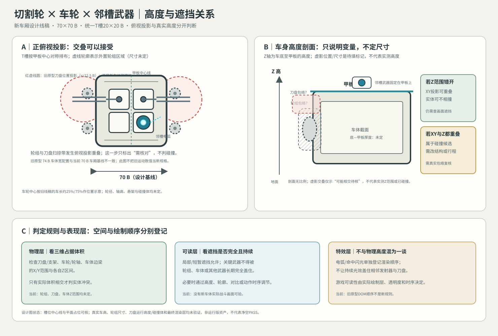

# 切割轮、车轮与邻槽武器分层示意 V0.1

日期：2026-10-22｜状态：关系示意；不是新车体尺寸图，不代表碰撞/遮挡验收通过。

## 本图要回答的问题

切割轮最大横向扫掠投影会覆盖外置轮组与车身边缘的部分平面范围。依用户确认的规则，这个二维重叠不能直接判为冲突；必须继续比对刀盘、支架、车轮/轮轴和车体边梁的真实高度区间与碰撞体，并检查武器本体是否被完全且持续遮挡。

图中把车底至甲板方向标为高度Z，把列车在屏幕上的前后方向留作平面Y，避免把顶视纵向间距误当成车体厚度。虚影的大小与相对位置只是待填空包络，不代表真实高度数据。

## 图中采用的数据与限制

| 内容 | 当前值/状态 | 来源与边界 |
|---|---|---|
| 设计车厢 | 70×70 B，4个T槽 | 当前已确认的L1规划尺寸；不代表运行原型车壳已迁移 |
| T槽中心 | x=±12 B，y=±11.5 B；节距24×23 B | 统一T槽规范；图面用3 px/B绘制 |
| 邻槽武器 | 右下槽放电弧发射器 | 用于展示相邻武器的本体识别；不改变占槽规则 |
| 切割轮投影 | 旧原型刀盘半径22.5 B、中心位置约±47.5 B起步 | 从现有原型工作包络摘取，仅作二维投影说明；不可据此认定新车体的刀盘高度或碰撞 |
| 轮组布置 | 车体外侧，纵向位置沿用约25%/75%的线稿关系 | 轮径、轮轴、轮组高度、悬架与碰撞盒均未定；图形非比例 |
| 现有原型宽度差异 | `vehicleBodyWidth=74 B`；本图设计车厢宽70 B | 两套基线不同；旧原型的74 B不能覆盖当前70 B设计决定，需后续单独迁移审查 |

## 判定方式

1. 若刀盘与车轮在X/Y投影上重叠，但Z区间分离，实体可不相撞；再确认画面遮挡是否可接受。
2. 若刀盘/支架和车轮在X/Y与Z区间都重叠，则是实体碰撞候选，需调整结构、运动范围或高度关系。
3. 电弧、火花、命中反馈只需安排清晰的渲染顺序和时序，不把特效覆盖区域当成实体碰撞体。
4. 最终视觉层级用实际战斗画面检查；SVG或旧原型DOM顺序只能说明画面绘制/示意关系，不能证明高度或物理净空。

## 状态

- 70 B设计车厢、居中槽阵列与邻槽示意：静态几何可核。
- 车体底—甲板厚度、轮组/刀盘高度、刀盘与轮组3D碰撞、遮挡时长：未定/未验证。
- 新车体运行资源、实际战斗画面、微信真机：未验证。
- 下一步需要车体侧视/剖面美术尺寸或项目正式的高度层配置后，才能填写真实Z区间并判定实体冲突；不以本图虚影位置作决定。
