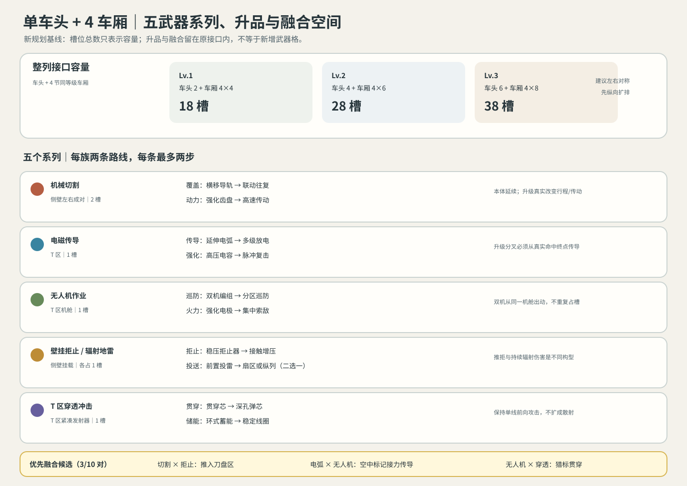

# 单车头 + 4 车厢：五武器系列、升品与融合规划 V0.1

> 版本提示（2026-10-21）：本文作为武器成长路线的历史规划参考；槽位尺寸与安装面改按[武器统一接口与五系尺寸规范 V1.0](./武器统一接口与五系尺寸规范V1.0.md)。文中切割、拒止等侧壁安装描述已废止，当前只使用统一T面接口。

日期：2026-10-18。状态：**规划提案；槽位数量采用用户本轮指定值作为本方案基线，不代表运行配置已经修改。**

## 1. 规划基线与边界

| 部件 | Lv.1 | Lv.2 | Lv.3 |
|---|---:|---:|---:|
| 车头 | 2 | 4 | 6 |
| 单节车厢 | 4 | 6 | 8 |
| 单车头 + 4 节同等级车厢 | 18 | 28 | 38 |

整列公式分别为 `2+4×4=18`、`4+4×6=28`、`6+4×8=38`。车头与每节车厢可分别成长，因此混合等级编组按各部件实际槽数相加；38 是全员 Lv.3 的容量上限，不等于建议把槽位全部塞满。

- 排布建议沿用左右对称、先纵向扩展：车头暂按 2×1、2×2、2×3；车厢暂按 2×2、2×3、2×4。它是槽位示意，不锁定车体外形尺寸。
- 1 个接口只承载 1 个武器本体。切割系统若占左右成对挂位，按 2 个接口计；其它单体按 1 个接口计。
- 升品、路线节点和跨系融合都在既有武器/接口上发生；新增攻击轨迹、力场或召唤物不自动算新接口。若设计出新的独立实体硬件，则必须另占接口并重新核对空间。
- 此处的“升品”是武器已选升级所导出的可见品质阶段，不增加独立经验条、货币或冷却。节点数值和伤害平衡不在本轮批准。

## 2. 五个武器系列与成长空间

| 系列 | 装配接口 | 基础武器身份 | 升品路线与终点 | 关键视觉连续性 |
|---|---|---|---|---|
| 机械切割 | 左右侧壁成对接口，双侧一套计 2 槽 | 贴壁刀盘，近身接触持续切割 | 横向覆盖：横移导轨 → 联动往复；切削动力：强化齿盘 → 高速传动 | 保留同一刀盘与支架；升级改变真实横移机构、齿盘和传动，不靠增加装饰刀片伪造等级。现有规划节点/数据沿用。 |
| 电磁传导 | T 区 1 槽/发生器 | 单一发射端、单条主电弧 | 多级传导：延伸电弧 → 多级放电；放电强化：高压电容 → 脉冲复击 | 本体增加可读导能环/电容结构；攻击从单线到命中终点分叉。多级放电必须是真正传导攻击，不能只加粗或增加无因果分叉。 |
| 无人机作业 | T 区 1 槽/机舱 | 机舱释放独立可见的攻击无人机 | 协同巡防：双机编组 → 分区巡防；机载火力：强化电极 → 集中索敌 | 双机升级从同一机舱释放，不另占机舱槽；机体保留基础轮廓，升级部件落在枪体/翼面/接收灯等真实结构。 |
| 壁挂拒止与辐射地雷 | 侧壁接口；拒止器和投雷器是不同武器构型，各自占槽 | 拒止器接触时推开；辐射地雷被抛出后在落点持续造成近距离穿透伤害 | 拒止壁垒：稳压拒止器 → 接触增压；辐射投送：前置投雷 → 扇区散布或纵列封锁（二选一） | 辐射不负责推拒，拒止不伪装成伤害光圈；投射距离/散布改变轨迹与落点，不把发射器拉长。候选节点无数值批准。 |
| 镭射武器 | T区1槽/紧凑固定式镭射发射器 | 沿列车前进轴的直线高能光束；穿透是可升级攻击效果 | 贯穿光路：聚束透镜 → 多层透镜；聚能发射：环式聚能 → 过载聚焦 | 本体保持紧凑；升级强化透镜、导能环与聚焦结构。始终是一条方向清楚的光束，不擅自变成散射、追踪或范围爆炸。候选节点无数值批准。 |

每族维持两条路线、每条最多两个节点：基础目录共 20 个专属节点（前三族现有规划 12 个；拒止/地雷和镭射武器共 8 个候选提案）。具体节点可见原[五武器家族词条树 V0.1](./五武器家族词条树V0.1.md)；本方案按新的整列和接口基线重新组织，不覆盖该旧版槽位配置记录。

## 3. 升品表达层级

品质表现跟随已经获得的节点，不另造一条成长系统：

| 表现阶段 | 触发口径（提案） | 资产变化原则 |
|---|---|---|
| 基础品 | 初始武器 | 清楚展示该系列的基础本体、安装方向和攻击端。 |
| 改装品 | 获得该武器任一升级节点 | 只增加/替换与节点对应的可见部件；原有轮廓仍能认出。 |
| 专精品 | 完成一条两节点路线 | 让路线终点的功能部件成为主识别点；另一条路线的视觉部件不混入。 |
| 融合品 | 同时装配两种不同系列，并获得对应融合节点 | 两个基础武器都必须仍然看得见；用连接反馈或联动动作表达关系，不把它们合成第三个模糊大物件。 |

“专精品/融合品”目前是展示层级提案；是否允许同一武器同时点亮两条路线，沿用当前升级获取规则，本轮不新设互斥或额外门槛。

## 4. 跨系融合：规模与首批候选

五族两两组合的理论上限是 `C(5,2)=10` 对。当前先保留 10 对的设计空间，但**不把 10 对都当成首发承诺**。首批建议落地 3 对，每对最多 2 个融合节点，共 6 个候选节点：

| 融合候选 | 一阶：建立可读联动 | 二阶：升级后的可见/战斗差异 | 接口与规则边界 |
|---|---|---|---|
| 机械切割 × 壁挂拒止器：拒止切割廊 | 拒止方向把接触敌人推向刀盘工作侧 | 拒止时机与刀盘横扫窗口衔接，让“推入刀盘区”可读 | 两件武器各占原接口；推拒作用区可与刀盘攻击区重叠，实体本体/运动扫掠不得穿模。若壁挂槽不合格，此融合暂停。 |
| 电磁传导 × 无人机：空中中继 | 无人机标记目标，电弧选取标记目标作为后续传导对象 | 多级放电从实际命中终点继续分叉，形成可见的空地接力链 | 无人机仍是独立飞行实体，电弧仍从发生器发出；不得凭空多出无人机或发射器。需落实多级传导逻辑。 |
| 无人机 × 镭射武器：猎标镭射 | 无人机标记高威胁目标，镭射发射器优先对准该目标所在光路 | 光束命中后沿同一直线继续贯穿后续目标 | 两件武器各占原接口；无人机只提供目标标记，不凭空生成第二个发射器，也不让标记自动等于额外伤害。 |

其余 7 对保持“未承诺”状态；只有存在清晰因果、可读反馈且装配/运行包络合格时再命名。尤其不把辐射地雷硬改成电弧导体，也不把纯伤害效果说成拒止控制。

融合节点默认原位升级，不增加接口；前置只要求两种来源武器都已装配，融合选择必须显式呈现。若未来要把融合做成独立实体武器，则必须重新做接口与最大运行空间审查，不能按本表直接免槽。

## 5. 满编成长容量怎么读

- 全 Lv.3 满编为 38 槽，算术上给了多个武器本体、路线升级和融合组合的容量；但容量不是玩法质量，槽位兼容与运行空间仍决定哪些组合能同时成立。
- 按最低装配成本粗算，一套左右成对切割系统占 2 槽，其余四族的单体构型各占 1 槽，五族同时各装一套至少 6 槽；融合升级仍占原槽。该数只说明“能容纳基本样机”，不证明某节车厢内可混装或全编组无冲突。
- 需要按每节车头/车厢的等级与位置建立“接口类型—可装武器—实体包络—运动/攻击包络”映射；有冲突时减少可兼容组合，不靠把槽数重复解释成额外武器空间。
- 车头接口适合前向 T 区系统；车厢 T 区与左右侧壁分别承担顶面武器和侧向实体。具体分配还须沿用已经提出的车头/车厢槽位示意核对，不能只用整列总数推导结论。

## 6. 本方案验收边界与下一步

- 本轮只建立规划基线与升级/融合结构；没有改游戏代码、运行槽位配置、伤害数值或美术资产。
- 容量加总 18/28/38、20 个家族节点、3 对首批融合/6 个融合候选节点、理论 10 对组合已复核；这是规划算术检查，不是实装或战斗平衡 PASS。
- 车体真实外形、接口坐标、满载实体与运行净空、三个候选融合的可视性、数值成长曲线、微信真机表现均为未验证。
- 下一轮应先把新头/厢槽位数映射回可视线稿和接口类型，再检查三对首批融合各自所需接口与运行包络；通过后再更新武器升品资产清单，不扩写其余融合对。

## 配图

