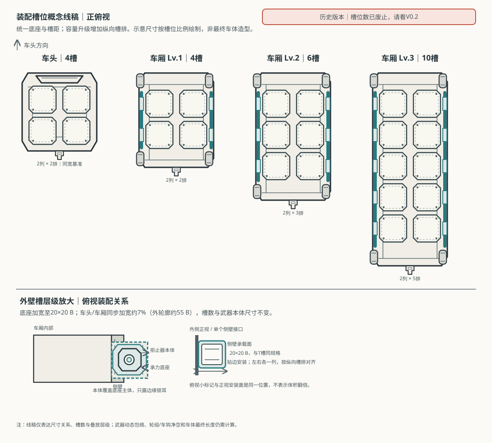

# 荒野列车武器装配槽位基础规范 V0.1

> **历史版本，已由2026-10-18玩家确认的新基线取代。**旧车头4槽、车厢4/6/10槽与2×5布局不再有效；当前规范为[武器装配槽位基础规范V0.2](./武器装配槽位基础规范V0.2.md)，当前线稿为[武器装配槽位线稿示意V0.2](./武器装配槽位线稿示意V0.2.svg)。本文后续内容仅供追溯，不能用来决定当前槽位数或载体矩阵。

日期：2026-10-16。状态：**结构方案候选，待玩家目测后再转入车头/车厢美术设计；不改变现行容量、战斗数值或碰撞规则。**

## 0. 本轮决策边界

用户要求暂时忽略当前车体图，先按现有武器类型及攻击方式规划槽位，再按槽位重做车头与车厢。本方案将现行容量直接落实为可见安装点：车头4个、车厢4/6/10个。沿用此前已确认的“车头与车厢同宽”和“T区采用等大底座”；允许车厢升级时沿纵向增加可见槽位和车体长度。根据玩家关于槽位识别度偏低的反馈，本轮把标准底座宽度由18 B增至20 B，并将车头/车厢同步加宽约7%，形成约55 B的车体外宽候选；容量、武器本体和碰撞规则不变。尺寸仍是新车体绘制与包络审查的候选基准，不是批准的玩法上限或碰撞门禁。

冲刺仍由车头品质/现有冲刺规则提供；助推器不列为可装武器，也不分配P区。下文不改装配经济容量、武器价格、攻击数值、命中规则和敌人碰撞。

### 槽位平面线稿

图中长度只用于表达槽排随容量增加；边梁、轮组、车钩与武器最大活动包络尚未完成尺寸求交，因此它是布局线稿，不是可直接投产的车辆设计。侧壁槽在正俯视中只标出沿边梁的接口锚点，完整的承载面尺寸另以外侧正视放大表示，避免把侧壁安装面误画成向车外悬浮的大型外挂块。

**代码差异待处理：**核对到当前 `station-prototype/config.mjs` 仍把 `boost` 列在可购买模块中（size=1），与用户已确认的“取消助推器武器、冲刺不依赖车厢助推器”方向冲突。本轮不擅自删除/改运行代码；后续落地游戏规则时需把这项旧配置作为单独迁移任务处理，不能把它画进新槽位图。

## 1. 槽位与包络必须分层

每个安装位置由四层数据组成，不能用一张小图或一个“容量格”同时代替：

1. **承载槽/底座**：车体上可见的结构接口，承担安装；装备覆盖在底座上方，绘制层级高于底座，允许遮挡底座主体，但必须看得出压板、锁扣、导轨或螺栓等连接关系。
2. **装备静态包络**：装备安装完成后本体的最大可见外形，包括支架、炮口、转盘、舱盖等；从正俯视能读出装备类别。不能把连接底座重复画成装备的一部分来缩小本体。
3. **机械运行包络**：实体活动部件在最大升级/最大行程下扫过的空间，例如切割轮横向伸缩与回程。相邻槽位之间不得相交；攻击效果可以穿过/重叠效果区，但实体不能穿模。
4. **攻击/飞行/投放效果域**：电弧传导、无人机巡航、拒止场、地雷弹道与落区等。它们不是车体安装槽，也不能拿目标索敌范围直接当实体占位。

坐标单位 `B` 仅指原型战斗 SVG 的绘制单位，不是屏幕像素、世界距离或容量单位。尺寸须按不透明可见轮廓测量，透明画布留白不得计入装备尺寸。

## 2. 通用标准槽

| 项目 | V0.1候选值 | 约束 |
|---|---:|---|
| 等大底座可见尺寸 | 20×20 B | 所有通用槽底座保持同尺寸、同材质体系；相较旧候选横向加宽约11%，提升车内识别度；武器本体尺寸与攻击规则不随底座放大。 |
| 横向中心距 | 25 B | 左右相邻底座间留5 B结构缝，两槽外缘总宽45 B；不能把左右两槽合成一个大底座。 |
| 纵向中心距 | 23 B | 前后相邻底座留3 B缝；槽位按独立模块绘制。 |
| 装备占位 | 一个标准位置=1容量点 | 多容量装备必须按占用数量逐件显示在对应位置；升级分支、发射效果和目标数变化不自动增加槽数。 |
| 视图层级 | 装备高于底座 | 底座先画，装备后画；武器与其承载底座必须同锚点、有真实连接，不能漂浮在车身外。 |
| 外壁装备覆盖关系 | 本体可见轮廓至少约16×16 B，承载面20×20 B | 拒止器主体压在底座上层，遮住底座大部分平面；只露出足以读出承重连接的边缘/锁扣。不得把小设备放在底座旁边，也不得让底座变成比设备更醒目的独立方板。 |

20×20 B 是本轮可读性修订后的统一底座候选；此前18×20 B为旧候选，已被本版取代。武器本体和动态效果包络不随底座放大，也不宣称新尺寸已通过所有武器包络。

## 3. 载体槽数与排布

沿用一个载体同宽、槽位成对横排的布局。槽位的横向位置固定，升级通过增加纵向槽排体现容量，不把多个等级的装备挤在同一块小区域。

| 载体/等级 | 通用槽数 | 排布 | 对应现行容量 | 车体设计要求 |
|---|---:|---|---:|---|
| 车头 | 4 | 2列×2排 | 4 | 前端保留撞角/视线，尾端保留车钩；中段车顶展示4个等大底座。冲刺机构属于车头内建结构，不占武器槽。 |
| 车厢Lv.1 | 4 | 2列×2排 | 4 | 基础车厢展示4个槽；两侧保留外壁安装结构与车轮净空。 |
| 车厢Lv.2 | 6 | 2列×3排 | 6 | 沿车长增加一排，形成清晰的中级外观，不缩小底座。 |
| 车厢Lv.3 | 10 | 2列×5排 | 10 | 沿车长扩展到五排，槽距和槽尺寸不变；高级车厢显著更长，不靠叠图/数字表达容量。 |

两列中心距25 B时底座横向占宽45 B；车头和车厢采用同一外宽，内部净宽至少满足45 B并留出结构边梁。线稿将车体外宽先定为约55 B候选，最终结构宽度仍需在车体断面设计时核准。车厢按容量升级增加纵向槽排，因此长度随等级增加；前后连接区及轮组长度需由本规范的包络校核确定，不能把旧车厢长94 B直接当新设计约束。

## 4. 按武器类型映射安装面与空间

标准槽是统一的承载接口；安装面可以是车顶或侧壁，但每个实体安装点都要对应一个标准槽编号，不能出现“武器占了容量、车上却找不到实物位置”。车厢侧壁槽位于左右外侧边梁，沿每个纵向槽排布置，并分别对应该排左/右两个标准槽；正俯视图仅画出接口锚点，侧壁安装面的标准承载面为20×20 B，与T槽等规格。它不是车身外侧额外增加的独立容量，也不能把俯视锚点当作设备静态包络。同一槽位可选车顶T面或侧壁面安装，二者是同一容量位置的两个安装面，不能同时叠装、也不额外增加容量。侧壁装备安装后覆盖对应边梁底座，武器本体在上层；底座只露出锁耳/压边。下表的空间域是设计检查对象，不代表已经验证可混装。

| 武器家族/当前状态 | 安装槽映射 | 实体及运行空间 | 非实体效果空间 |
|---|---|---|---|
| 机械切割 / 现役 | 车厢侧缘的成对L/R槽；一套双侧切割系统占用两个对称安装点。多套系统沿纵向分排，不叠在同一个T底座上。 | 每个刀盘、横梁、导轨与压板均计入实体包络；按`sawLinked`最大横向往复行程审查，不能遮住车轮或侵入相邻车体。 | 接触伤害范围跟随刀盘实体扫掠；命中反馈不额外产生第二套碰撞体。 |
| 电磁传导 / 现役 | 一个T标准槽一个电弧发生器；发射端与底座同中心、方向朝车体两侧/目标区。 | 绕组、双叉口及升级导能环属于同一装备本体，必须在单槽最大静态包络内；强化不能复制成多个虚假发射器。 | 基础为一条放电链；多级升级从已命中目标终点继续分叉/传导，效果链不占额外槽。 |
| 无人机作业 / 现役 | 每个无人机舱实体各占一个T槽；容量消耗数量对应画面中的独立舱体，不允许一个舱横跨多格伪装数量。 | 每舱独立舱盖/弹射口；升级出的两架无人机从同舱出发，飞机的飞行路径与敌人攻击属于空中运行/效果域，不扩大车体静态槽。 | 巡航、分散索敌、集中索敌与命中效果分开建模；索敌距离不是舱体包络。 |
| 外壁拒止 / 候选 | 使用车厢边缘的侧壁槽，与对应底座/承力面重合；拒止器主体必须覆盖承载底座上方并遮挡其主体，底座只在边缘露出连接结构。左右侧各自编号，实际安装侧由装备分配决定。 | 拒止器、嵌入壁面的承力框及突出件整体计入静态包络；不允许设备中心漂在车侧之外，也不能遮轮。 | 力场只在触界时产生推开反馈；场域可与刀盘攻击域重叠，但不是额外武器实体。 |
| 辐射地雷投射 / 候选 | 使用车厢侧壁槽；一个投射器占一个侧壁安装点。与拒止器同属防御家族，但硬件/落点策略必须可识别、可单独配置。 | 投射口、弹仓、蓄射机构均计入静态包络；抛射时运动的弹体不算车体固定硬件。 | 单枚雷的弹道、落点、持续伤害区单独核验，必须避开车体/车轮/刀盘实体扫掠；禁止用旧页面示意线当射程。 |
| T区穿透冲击 / 候选 | 一个T标准槽一个紧凑发射器；攻击轴沿列车前进方向。 | 发射器与后座结构留在单槽内，升级不能靠额外炮体超出槽边。 | 穿透路径及命中效果按战斗规则计算，不占相邻槽。 |
| 冲刺/推进 / 非武器 | 不分配装配槽。车头品质相关的内建动力结构属于车头造型与车辆功能，不恢复P区助推器装备。 | 不新增外置火箭短舱或车厢助推器实体。 | 整备站出发与途中冲刺的效果状态沿现行规则表达；不得把喷焰画成可安装武器。 |

## 5. 升级与重复装备的视觉规则

- “多件装备”按件数占据不同槽，逐件画出；不得把三舱合并成一张跨三槽大图，也不得只在按钮上显示数字。
- “一件装备升级”保持原槽位和占用数量；升级差异落在本体部件或攻击效果上。例如电弧升级增加导能部件并从目标终点分叉，不增加假炮口；无人机数量升级显示同一舱释放两机，不占第二舱位。
- 车厢容量升级与可见槽数一一对应：4→6→10。新增槽位必须是新增真实底座/安装面，不能通过把原有设备缩小或挤密解决。
- 同槽不可叠装两个独立实体。若某视觉组合要求两类独立武器共用一个位置，必须先明确其是否为一个组合装备；否则分槽或判冲突。

## 6. 仍待包络计算的项目

本轮只建立槽位骨架，不批准具体武器和车体资产。下一轮先按一个槽位族计算最不利实体包络，并由其反推车体长度、侧梁、车轮和连接器位置；重点核验刀盘最大横移、拒止器覆盖底座后的侧向边界、地雷最大抛射/落点、满载槽间距，以及列车相邻车厢的连接净空。只有这些不相交后，才进入车头/车厢的新外形图。

不沿用当前车体坐标、浮空的助推器P布局、当前车辆贴图锚点，也不把临时试演资产视作已批准底座。旧文件和资源继续保留作历史，不在本轮清理或覆盖。

## 7. 本轮验收状态

- 需求与当前武器/容量代码对照：**部分PASS**（容量4/6/10及切割轮/电弧/无人机数据核对通过；代码仍将旧助推器列为购买模块，与新方向冲突，记录待迁移，未改代码）。
- 槽位数量映射：**PASS（方案内部一致）**（T槽数与现行容量一致；侧壁安装面仍映射到槽编号，不额外创建容量）。
- 具体武器静态/动态净空与车体外形：**未验证**（本轮未做空间求交，也未产出车体图）。
- 运行页面/微信真机：**不适用**（只建立文档方案，未改运行代码与资源）。
