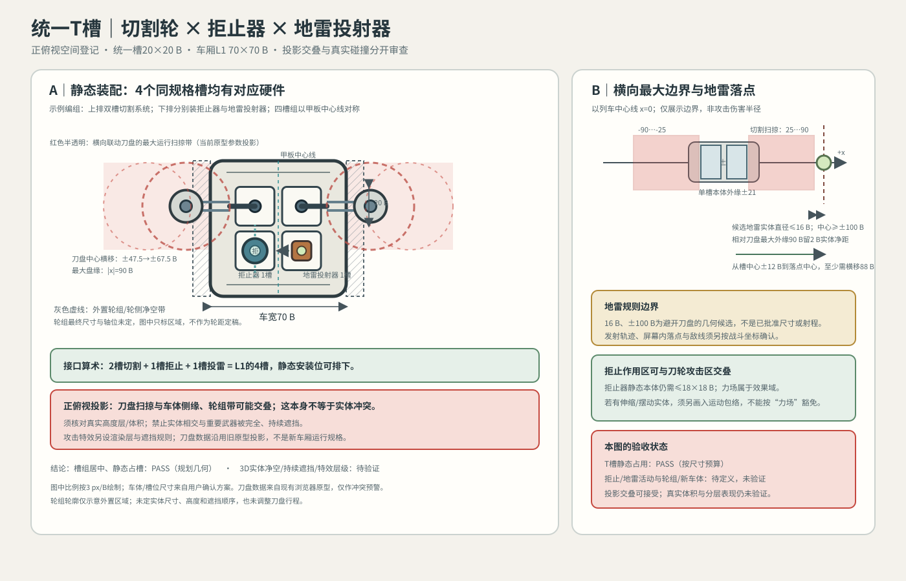

# 统一T槽切割与防御模块包络登记 V0.1

日期：2026-10-21。状态：统一接口方案下的第一张空间审查图；已修正槽阵列偏左错误，并按用户确认把俯视投影交叠与真实空间碰撞分开。**不是运行版验收，也不批准地雷射程。**

## 本轮目标 / 非目标

- 目标：验证L1单节车厢4个统一T槽是否能静态容纳双槽切割、一件拒止器和一件地雷投射器；把切割轮旧原型的最大动态边界映射到新车体尺寸上，供后续检查实体体积和可读性。
- 非目标：不改运行武器位置、碰撞、攻击数值、轮组、车体贴图或投雷逻辑；不把旧原型坐标当作新车厢正式几何。
- 验收：槽组相对甲板居中、统一槽中心与包络计算可复核；静态占槽清晰；实体体积、投影交叠、效果域和特效层级分别标注；未掌握尺寸明确标“未定”。

## 尺寸输入与计算

### 已确认的载体/槽位规划

- L1车厢：70×70 B，2列×2排，4槽；单槽20×20 B，中心横距24 B、纵距23 B。槽中心为x=±12 B、y=±11.5 B，整个槽阵列中心与甲板中心线重合。此前线稿把槽列画在x=-21 B与+1 B，整体偏左；本次已纠正为x=-12 B与+12 B。
- 车体中心线为x=0，则槽中心x=±12 B。居中单槽硬件预算≤18×18 B，外侧边缘最多到|x|=21 B。
- 本图以最紧凑且能说明三种功能同厢的占位例子绘制：一套双槽切割占同排左右2槽；下排左右分别为1槽拒止器和1槽地雷投射器。占用合计4槽。L1静态装配容量算术通过；这不是对所有升级态的动态兼容承诺。

### 切割轮：现有原型的最大活动包络投影

当前原型`station-prototype/configs/mount-layout.mjs`与`src/game/upgrades.mjs`记录：`sawReach+sawLinked`时刀盘半径22.5 B；刀盘中心横移约`47.5…67.5 B`；最外实体边缘为`|x|=90 B`，最内实体边界为`|x|=25 B`。同一代码的双切割器纵向中心为`y=3/47 B`。这些是**现有原型战斗场景单位**，不是新车厢/新接口的最终比例规格。

按用户确认的新单槽坐标，单槽静态本体外边缘|x|≤21 B，与切割轮内侧扫掠边界25 B之间有4 B算术间距。刀盘及支撑结构的横向动态范围为|x|25…90 B，会覆盖车身半宽35 B以外的侧缘区；投影还会向车体可视轮廓内覆盖约10 B。**这是正俯视图上的投影关系，不代表实体碰撞结论。**用户已确认：只要武器处于不同高度/纵深层，俯视投影可交叠；前提是没有真实体积相交、关键武器没有被完全且持续遮挡，并且攻击特效分层避免互相覆盖。轮胎/轴位/深度层尺寸尚未定，故真实3D净空和视觉遮挡仍未验证。

## 用户确认的分层与交叠规则

- 俯视投影相交不自动判为装配冲突。判断实体碰撞时，要比较武器、车体、轮组在X/Y位置与高度层上的真实占据体积。
- 不同高度层的武器可以在画面中部分交叠；若关键武器被完全并持续遮住，则仍是识别问题，需要改变高度、位置、描边/对比或动作时序。
- 武器本体和攻击特效分别登记渲染顺序。活动特效可短暂叠加，但不能长期吞没邻近武器本体；效果域交叠与特效绘制资源冲突也是两类问题。
- 尚无每种武器的高度范围、碰撞体和最终渲染层配置，因此当前只能确认规则，不能声称实体净空或画面遮挡已通过。

## 防御件边界

- **拒止器：**静态硬件按一个同规格T槽、实体≤18×18 B预算。力场是作用区，可与刀轮攻击区叠加，不构成硬件碰撞；拒止器是否含外伸或摆动实体仍未定义，相关部分未判定。
- **地雷投射器：**静态发射器按一个T槽、实体≤18×18 B预算。旧设计卡曾以“地雷实体直径≤16 B、落点中心|x|≥100 B”作为避开刀盘最远外缘90 B并留2 B的候选。按新槽中心|x|=12 B，直线侧向落点至少需要约88 B位移。这些值只代表几何安全候选，不是射程、弹道或正式武器规格；落点是否在战场与敌人路径内尚未确认。

## 审查结果

| 项目 | 结果 | 说明 |
|---|---|---|
| L1静态槽占用 | PASS（规划几何） | 2 + 1 + 1 = 4槽；各单槽硬件不超过18×18 B预算，切割占用左右同排槽。 |
| 刀盘动态扫掠与单槽本体 | 条件PASS | 按当前源代码外缘25 B、单槽本体边缘21 B，余4 B；需把刀盘支撑根正确连接到两个T槽锚点。 |
| 刀盘动态扫掠与车体侧缘/车轮 | 未验证（3D） | 俯视投影覆盖车体边缘约10 B并覆盖轮组纵带；按用户规则，投影交叠本身不构成失败。实体体积和高度层数据缺失，尚不能判断碰撞。 |
| 拒止力场与刀轮作用区 | 可重叠 | 允许效果域重叠；真实推拒时序/受力表现未实现或核验。 |
| 投雷路径与安全落点 | 未验证 | 16 B地雷、±100 B落点及88 B位移均为几何候选，不批准为运行常量。 |
| 全车列/实战/微信真机 | 未验证 | 只做设计几何计算与层级规则更新，未接入新载体美术或运行配置。 |

## 需要解决的关键问题

1. 明确车轮、车体与刀盘的真实高度范围/碰撞体，以及谁遮挡谁；再判定扫掠投影交叠是否会形成实体碰撞或长期遮挡。只有同一空间体积相交才是物理冲突，不应仅因俯视投影重叠就调整槽位。
2. 双槽切割的两个T锚点到外侧刀盘/滑轨的承力路径如何连接？标准槽本体预算只能约束锚点，不能把一条超长滑轨算进44×20 B静态包络。
3. 地雷落点的设计距离和敌线由战斗坐标定义后，再与候选`|x|≥100 B`安全边界交叉检查；若战场不足以容纳，则改投射方向/布雷策略，而非减小槽尺寸或让地雷落进刀轮扫掠。

## 验证记录与下一步

- 本轮修正：四槽中心x为±12 B且几何中心与车厢甲板中心线重合；行中心y为±11.5 B；刀盘扫掠投影重新居中到同一车体坐标系。
- 文档与SVG静态结构/数值复核：静态槽数和4 B间距算术PASS；槽组偏移纠正。
- 目视审查图：按3 px/B比例绘制；明确表达投影重叠与真实体积冲突的区别，不是最终游戏画面。
- 游戏预览、碰撞代码、微信真机：本轮未修改/未验证。
- 下一步：为各武器/轮组登记高度层、实体碰撞包络和本体/特效渲染层，再检查真实碰撞与完全持续遮挡；投影交叠本身不作为阻断条件。之后核实T面拒止/地雷硬件的原画适配与落点安全距离。未完成前不宣称全局空间PASS。
