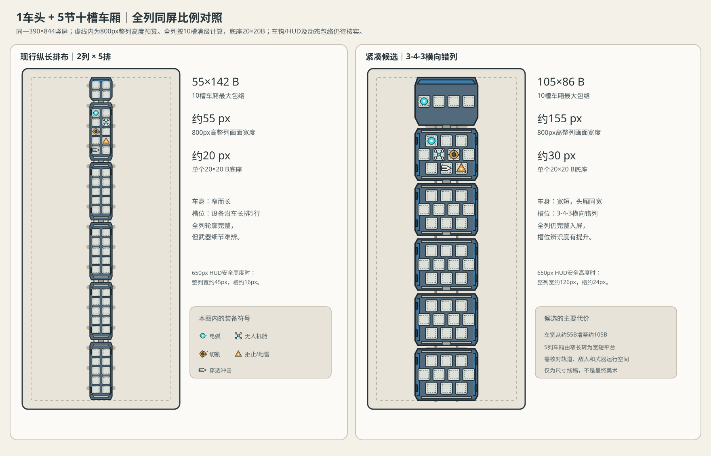

# 车列完整可视与武器槽位规模联合评估 V0.1

> **历史评估，最大编组和接口规则已更新。**本文以1头+5厢、车头4槽和旧车厢矩阵计算；当前改为1头+4厢、车头2/4/6槽、车厢4/6/8槽。不要把本文旧容量/比例结论当作现行线稿依据；请看[槽位规范V0.2](./武器装配槽位基础规范V0.2.md)。

日期：2026-10-17。状态：**方案评估，不批准运行改动或最终车体美术。**目标是同时检验“1车头+5节车厢整列可见”和武器系统的装载/组合规模，不以缩小武器图标作为默认解法。

> 结构方案已由玩家反馈更新：本文第3、6节的3-4-3错列候选已废止。当前采用规则化的2×2→2×3→4×3成长与车头供能接口等级，见[V0.2联合方案](./车厢纵横扩展与车头供能接口方案V0.2.md)及其[比例图](./车厢纵横扩展与供能总线比例图V0.2.svg)。本文件保留此前尺寸和武器体系规模的历史计算，避免把历史结论误当成当前布局。

## 1. 基线与计算口径

- 单一竖屏基准：390×844 px。先按屏高800 px可供整列使用（上下各预留22 px）估算；实际战斗HUD安全高度尚未测量，因此另列650 px敏感性结果。
- 当前线稿V0.1：统一外宽约55 B；车头约55×57 B；10槽车厢为2列×5排，约55×142 B；标准槽20×20 B、横向中心距25 B、纵向中心距23 B。B为图面设计单位，不是屏幕像素。
- SVG中的连接段约6.3 B。全列按5个车间连接段估算，不把车头最前端另加车钩。
- 车厢最大容量按每节10槽计算；此处不沿用“只有一节10槽、其余都是最短车厢”的较乐观情形。

## 2. 车体最大尺寸与整列显示冲突

### 沿用2列×5排

当前线稿比例下，1+5且五节均为10槽的列车纵向尺寸约为：

`57 B（车头）+ 5×142 B（车厢）+ 5×6.3 B（连接）≈ 800 B`

因此在800 px整列高度内，约为1 px/B：

| 部位 | 候选图面尺寸 | 整列缩放后的屏幕尺寸 | 判断 |
|---|---:|---:|---|
| 车头 | 55×57 B | 约55×57 px | 车头及功能细节偏小 |
| 每节10槽车厢 | 55×142 B | 约55×142 px | 车体仅占屏宽约14% |
| 单个底座 | 20×20 B | 约20×20 px | 武器类型/升级部件难以清楚辨认 |

若HUD把可用屏高压到650 px，整列宽度将进一步降至约45 px，底座约16 px。故该排布在几何上能缩进屏幕，但**不满足整列成长和武器可读性同时成立**的目标；“能完整出现”不等于“显示效果合格”。

### 反推可读性所需宽度

以车列整体至少约130 px宽作为本次比较用的可读性候选（不是已批准门槛），沿用55 B宽车体时需达到约2.36 px/B；五节10槽车厢加车头将占约1,890 px纵向空间，是800 px预算的约2.36倍。只改镜头缩放不能同时满足两项要求，必须缩短10槽车厢纵向长度并拓展横向槽位排布，或另行改变展示结构。

## 3. 紧凑槽位候选：3-4-3横向错列

保留20×20 B通用底座与25 B横向中心距、23 B纵向中心距；把10槽由2×5改为三排错列：前排3槽、中排4槽、后排3槽（左右对称）。按4列最大横向跨度、约3排纵向跨度，并为边梁、轮组/连接端预留结构余量，提出以下**待画线稿验证的尺寸包络**：

| 部件 | 最大候选尺寸 | 说明 |
|---|---:|---|
| 车头 | 约105×80 B | 与车厢同宽；现有4个T槽可先保留2×2，车头周边留给车首装甲、驾驶/动力结构。 |
| 10槽车厢 | 约105×86 B | 3-4-3共10个标准槽，纵向尺寸从约142 B降至约86 B；宽度从约55 B增至约105 B。 |
| 连接预留 | 约6.3 B/节间 | 只作比例估算，必须由新车钩结构复核。 |

整列估算为`80 + 5×86 + 5×6.3 ≈ 541.5 B`：

- 800 px可用高度：约1.48 px/B，列车宽约155 px、单个20 B底座约30 px；10槽厢约155×127 px。
- 650 px可用高度：约1.20 px/B，列车宽约126 px、单个底座约24 px；10槽厢约126×103 px。

此方案使全列在单基准视口里保留约32%–40%的屏幕宽度，并把槽位从16–20 px提高到约24–30 px；比现行2×5更接近“全列可见且能看出装备增长”。代价是车体宽度约为现候选的1.9倍，车厢变为宽短型战斗平台；必须检查轨道/敌人空间、列车识别、轮组净空、武器静态及最大运行包络，以及真实HUD遮挡。105×86 B是反推目标，不是最终定稿尺寸。

## 4. 5武器家族需要多少基础槽位

要区分三种不同的“数量”，不能互相代替：

1. **基础家族数：5个。**当前体系是机械切割、电磁传导、无人机作业、外壁拒止/辐射地雷、T区穿透冲击。它们是五种成长身份，不是五个固定专用底座。
2. **同时装一件各家族的容量需求：约6个容量点。**按当前设计口径，切割系统占一对侧向位/2点，其余电弧、无人机舱、拒止/投雷、穿透发射器各1点。10槽车在容量账面上可容纳这套组合并留4点余量；实际几何混装仍未通过动态包络审查，不能据此宣称可装。
3. **最大编组的容量上限：54点。**车头4点+5节10槽车厢×10点。它表示最多可承载的装备容量，不表示需要54种武器，也不自动保证所有装备组合无冲突。侧壁面与T面仍是同一容量槽的安装面选择，不翻倍计数。

## 5. 与《向僵尸开炮》参考样本的内容规模对照

只按用户提供的技能表样本计数，不外推为原作完整/官方清单：样本约11个明确基础技能、38条基础/进阶词条、7–8个终极形态，4套前置配方完整。

| 维度 | 参考样本 | 荒野列车当前规划 | 对照结论 |
|---|---:|---:|---|
| 基础身份/技能 | 11项 | 5个家族根 | 根数较少，但每个家族承担多条职能路线 |
| 升级节点 | 38条 | 20条（每家族4条） | 当前约为样本一半，不足以声称升级宽度相当 |
| 终端形态/组合 | 7–8项 | 8个路线终点/终端构型 | 数量级接近；并非所有项目都已有完整前置配方 |
| 完整前置配方 | 4套 | 现役/候选结构待逐族落地 | 不能仅按8个终点推导已有8套完整组合 |

因此无需把基础槽位增至11个来追平样本：基础槽位解决“同时装什么、装在哪里”，不是技能目录数量。若产品目标真是接近样本的升级选择密度，5家族可先保留，再把节点目标由20提高到约35–40（每族7–8条），终端构型维持约8–10个，并明确每个终端的前置链。当前20节点/8终端是较精简的首发规模，不是等量复刻。

## 6. 联合结论与下一阶段

- **现有2×5、55 B宽、142 B长的10槽车厢：**不适合在390×844内同时呈现“1+5全列”和清楚的武器细节。问题是槽位横纵布局与整列镜头目标冲突，而不是简单把武器图做小。
- **建议进入下一轮候选线稿：**统一车头/车厢最大外宽约105 B；Lv.3车厢采用3-4-3共10槽、最大纵向约86 B；车头在同一最大外宽内保留4个T槽。4槽/6槽低级车厢应在此统一宽度下形成自然的留空/结构差异，待线稿验证，不臆造槽位。
- **空间玩法规模：**保留5个基础家族；一套各家族构筑约需6个容量点；10槽车容量账面充足。若追求接近参考样本的构筑密度，优先扩充升级节点至35–40，而不是增加专用硬件槽位/基础武器身份。
- **未验证项：**新排列对武器锚点、刀盘全行程、拒止/地雷投射、轮组、轨道环境、整列真实HUD安全区的影响；车头/车厢新画面与微信真机均未验证。下一小交付应只完成3-4-3紧凑排布与同宽车头的比例线稿，再按玩家目测决定是否进入车体美术，不改运行游戏。
