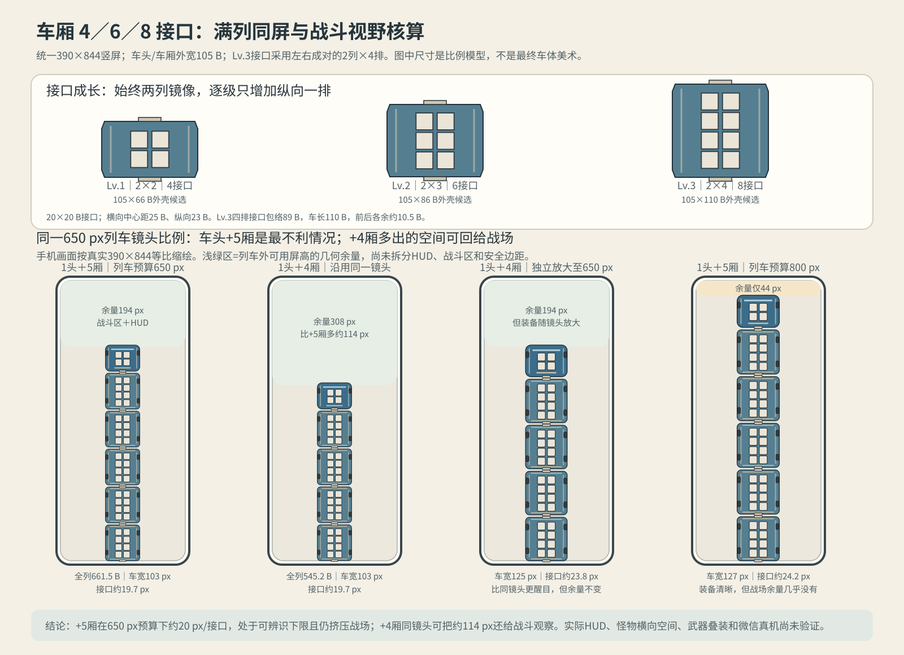

# 车厢 4／6／8 接口满列同屏评估 V0.1

日期：2026-10-18。状态：**历史比例评估；槽位数沿用，但最大编组和车头接口已更新。**当前正式规划基线见[槽位规范V0.2](./武器装配槽位基础规范V0.2.md)和[新线稿](./武器装配槽位线稿示意V0.2.svg)：最大为1头+4厢，车头2/4/6槽、车厢4/6/8槽，同级整列18/28/38槽。以下车体比例仍是旧候选估算，不代表线稿尺寸已定。

> 下方旧比例图仍包含1头+5厢对照，属于编组上限变更前的历史图；查看当前接口分布请使用V0.2线稿。

## 结论

**按旧车体尺寸估算，1头+4厢能放进390×844画面；但“完整列车 + 足够大的武器 + 足够战斗观察区”仍不能只靠缩放保证。**当前最大编组就是1头+4厢，战斗视野是否足够尚需真实画面验证。

按当前选定的最大编组，车头分别为2×1/2×2/2×3（2/4/6接口）；车厢为2×2/2×3/2×4（4/6/8接口）。升级始终增加一排，不产生奇数列或左右槽位配对问题。满级车厢的105×110 B外包络仍只是旧估算候选，槽体、轮组和端部结构还需线稿复核。

Lv.3两列接口只占约45 B横向跨度，若车厢仍与车头等宽105 B，两侧各约有30 B结构空间。它们应由承力侧梁、轮组罩和供能结构构成，而不能留成两片空甲板；这既是外观设计要点，也是不新增接口容量的结构区。

## 估算口径

- 视口固定390×844；车头与各级车厢外宽统一按105 B，车头长80 B，满级车厢长110 B，车间距按6.3 B。
- 车厢升级为2×2、2×3、2×4矩阵；单接口20×20 B，横向中心距25 B、纵向中心距23 B。4排接口纵向包络为89 B，110 B车长余21 B供前后端梁/结构使用。
- 当前最大编组1头+4厢总长估算：`80+4×110+4×6.3=545.2 B`。旧1头+5厢数据已不适用于当前编组。
- 800 B/650 B是列车纵向显示预算，不是已测得的游戏HUD安全区。剩余屏高还要容纳战斗区域与HUD；实际可见战场高度须在真实战斗镜头中确认。

## 结果

| 编组与镜头预算 | 全列高度 | 列车宽度 | 单接口显示 | 屏幕剩余高度 | 判断 |
|---|---:|---:|---:|---:|---|
| 1头+4厢，列车预算800 px | 800 px | 154 px | 29.4 px | 44 px | 接口较大，但剩余区域不足以证明战斗观察不受影响 |
| 1头+4厢，列车预算650 px | 650 px | 125 px | 23.8 px | 194 px | 接口更易辨认；剩余194 px还需分给HUD与战斗画面，仍须真实镜头核对 |

上述“剩余屏高”是纯几何余量，未扣除真实HUD、敌人活动区、手指遮挡或镜头安全边距。以800 px预算展示1+5时只有44 px余量，明显不能把“整列塞进屏幕”当作战斗视野合格。650 px预算的1+5方案虽可显示约20 px接口，但194 px是否够用仍需真实战斗构图验证。

## 槽位数量与武器布置

- 当前最大编组的同级接口总数为Lv.1 `2+4×4=18`、Lv.2 `4+4×6=28`、Lv.3 `6+4×8=38`；旧“1头+5厢”和“车头4槽”只保留作历史计算。
- 每厢8接口可容纳目前估算的约6点五家族混合构筑，账面余2点；切割轮等需占对称接口的武器仍需保留配对位置。接口数量足够不代表所有最大运行包络都能共存。
- 用户当前已明确车厢各级接口4/6/8、车头2/4/6；规划上接口数即可见装配容量。运行配置是否同步仍需单独落地，本轮不改游戏代码。
- 外壳尺寸、侧梁/轮组的具体结构，以及Lv.3接口容量8如何与现有10容量配置映射：**待确认**。若接口就是容量，现有10需改为8；本轮没有任何配置迁移。

## 验收状态与下一步

- 4→6→8接口数量、偶数列与左右镜像排列：**方案内部PASS**。
- 整列长度、显示宽度、接口像素尺寸：**公式核算PASS**，基于候选B尺寸。
- SVG结构解析与浏览器版式检查：交付前校验。
- HUD实际安全区、战斗观察效果、武器最大运行包络、触控遮挡、微信真机：**未验证**。
- 当前后续画面评估对象改为**1头+4厢**。本文件的比例数字仍基于旧车长候选；须先按V0.2线稿确定车体外形，再看全列成长展示与战斗视野，不据此改镜头。
