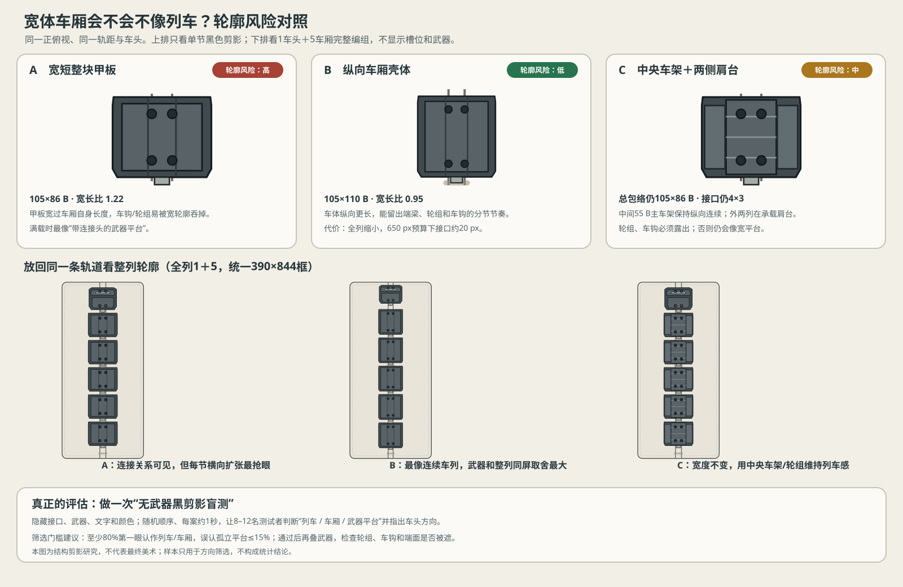

# 车厢宽体轮廓识别风险评估 V0.1

日期：2026-10-18。状态：**启发式评估＋可目测对照，不是玩家实测结论；不修改车体规则或运行版。**评估目标是：4×3接口解决武器搭载后，宽车厢是否仍被直觉识别成列车车厢，而非孤立的武器平台。

## 结论先行

风险确实存在，尤其是Lv.3车厢。当前候选宽105 B、长86 B，宽长比约1.22；俯视时车厢比自己更长，4×3矩阵又接近铺满甲板。如果侧梁、轮组和车钩被武器遮住，单节容易被读成“横向平台”。整列重复连接会补回一部分列车感，但不能只靠连接关系兜底。

更稳的候选不是放弃横向槽位，而是在4×3保留不变的前提下，让轨道、轮组、车钩和纵向主车架仍主导轮廓。图中并列三种外形：

1. **A 宽短整块甲板（当前比例）**：105×86 B，识别风险高。搭载面积最大，但车厢宽过自身长度，且槽面易成为外轮廓主体。
2. **B 纵向车厢壳体**：105×110 B，4×3接口不变，把多出来的纵向长度用于前后车架、轮组区和清楚的端部。列车轮廓风险较低；代价是每节更长，全列缩放后单个接口会变小。
3. **C 中央轨道车架＋两侧武器肩台**：总包络仍105×86 B，中间保留55 B纵向主车架，外侧两列落在结构化肩台上。列车感风险中等；轮组/车钩需外露且与主车架连成整体，否则肩台仍会像外挂武器平台。

## 可观察的判据

不以“像不像火车”作为单一主观结论，拆成四个可观察信号：

| 判据 | 通过时应看到 | 风险表现 |
|---|---|---|
| 纵向主轴 | 车头、车厢、车钩沿同一轨道方向串接 | 车厢方宽，横向甲板成为主轮廓 |
| 轨道承载证据 | 轮组/转向架在轨道上清晰可见，车体由其承载 | 轮组被遮住，或画在远离轨道的位置，车厢像漂浮平台 |
| 节段分离 | 每节车厢都有明确端面、车钩间隙和独立车架 | 相邻宽甲板贴成连续大平台，列车分节消失 |
| 车头—车厢层级 | 车头有明显前端、驾驶/动力识别，车厢重复且相连 | 车头和车厢都是同形矩形模块，整列像模块板阵 |

## 建议的两步验证

**第一步：无武器黑色剪影盲测。**固定390×844视口、相同车头、轨道和1+5编组；隐藏接口格、颜色、文字和武器，只保留轮廓、轮组、车钩。随机顺序显示三案，每案约1秒，让测试者回答“这是列车/一节车厢/武器平台/其他”，并指出车头方向。内部快速筛选可先用8–12人；目标是至少80%第一眼选“列车/列车车厢”，且不超过15%选“孤立武器平台”。小样本只用于筛设计，不当作统计定论。

**第二步：实际载武器识别检查。**只对剪影通过的案子显示4×3接口与代表性武器；检查武器是否遮轮组、车钩和端面。至少使用切割轮、外壁拒止/投雷、无人机舱三种最容易遮边缘结构的组合；不需把所有武器组合逐个演示。

每个方案都保持同一相机、轨道宽度、车厢长度/间隔、光照与屏幕占比。否则测试测到的是缩放或美术细节差异，不是轮廓结构差异。

## 当前风险判断与建议

- A宽短整块：**高风险**，目前不建议作为正式车厢外形直接定稿。
- B纵向壳体：**低轮廓风险／中可读性风险**。满列长度为`80 + 5×110 + 5×6.3 = 661.5 B`；390×844视口按800/650 px高度预算时，车宽约127/103 px，接口约24/20 px。它更像车厢，但650 px预算下武器辨识可能变弱。
- C中央车架＋肩台：**中轮廓风险／中结构风险**。不拉长整列，仍约155/126 px宽、30/24 px接口；但必须确保两侧肩台看起来是承载车架的一部分，且轮组真正在轨道线上、车钩和端梁露出。

建议先拿B和C做真正的无武器剪影对照，A仅作为风险基准；不根据本次启发式评分直接批准任一车体。若只能先选一个打样，优先C：它保留原同屏比例并保留纵向主车架，较能平衡当前“整列成长可见”和列车识别。C过不了盲测，再转B并接受槽位小一档的代价。

## 验收状态

- 候选比例的几何推算：**PASS（公式）**。
- 轮廓风险启发式：**已评估，非玩家数据**。
- 对照图SVG结构解析：**PASS**；浏览器页面目检：**PASS（标题、三种单车剪影、三组全列、盲测说明无裁切/覆盖）**。浏览器日志仅有本地预览`favicon.ico`未提供的404，不影响SVG加载。
- 玩家盲测、实际武器遮挡、战斗HUD、轨道/怪物横向空间、微信真机：**未验证**。
- 运行版、车体资产和容量：**未修改**。
