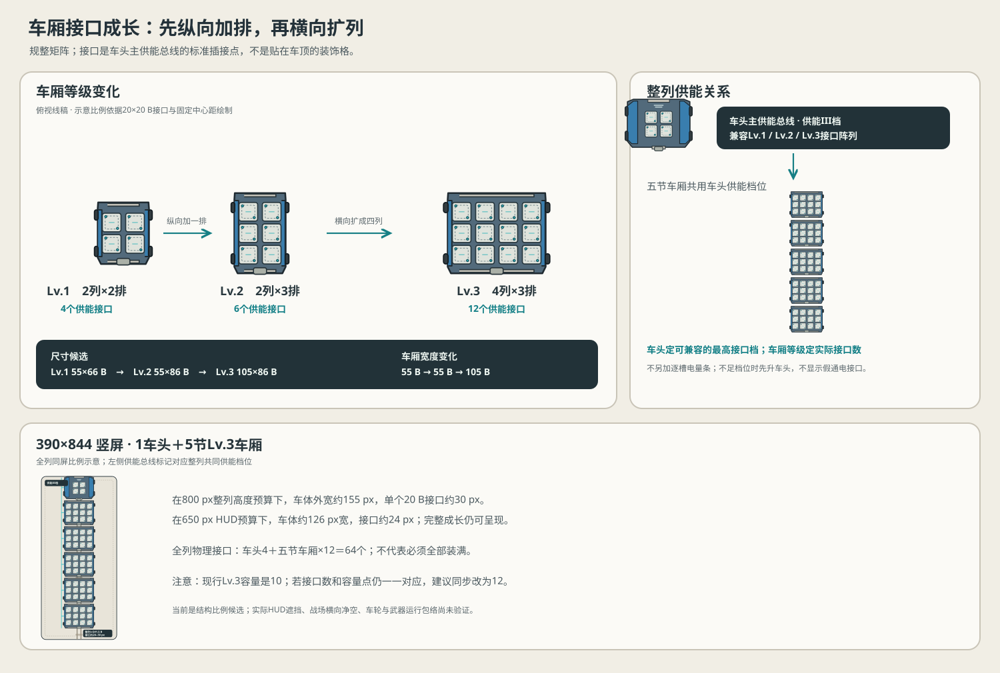

# 车厢纵横扩展与车头供能接口方案 V0.2

> **已被2026-10-18新基线替代。**本文的车头4槽、车厢Lv.3 12槽、1头+5厢等方案不再是当前设定。现行槽位与排布见[槽位规范V0.2](./武器装配槽位基础规范V0.2.md)和[线稿V0.2](./武器装配槽位线稿示意V0.2.svg)。以下比例/供能推演仅作历史记录。

日期：2026-10-17。状态：**结构候选，供目测审阅；不改运行版车体、容量、武器或战斗规则。**本版按玩家新方向重排车厢成长，并以图示同步评估整列比例。

## 1. 核心结构

车厢上的槽不是单纯的“格子”，而是武器与列车主供能总线之间的**标准能量接口**。每个接口都同时提供可见的安装锚点与供能接点；武器按真实接口安装，不把能量线路、底座和武器本体画成同一个模糊部件。

车厢升级分两步扩展：先纵向增加一排，再横向增加两列。规律始终是规整矩阵，不采用3-4-3错列：

| 载体 | 接口矩阵 | 接口数 | 相对上级的成长 | 外形包络候选 |
|---|---:|---:|---|---:|
| 车头 | 2列×2排 | 4 | 车头自身保留4个T接口；车头同时承载主供能总线 | 约105×80 B |
| Lv.1车厢 | 2列×2排 | 4 | 初始形态 | 约55×66 B |
| Lv.2车厢 | 2列×3排 | 6 | 只沿列车纵向加一排 | 约55×86 B |
| Lv.3车厢 | 4列×3排 | 12 | 在Lv.2基础上横向扩成四列 | 约105×86 B |

统一标准接口仍按20×20 B、中心距25 B（横向）×23 B（纵向）绘制。4列时四个中心为−37.5、−12.5、12.5、37.5 B，接口外缘总跨度95 B；车体最大宽暂按105 B留出两侧各约5 B结构边梁。Lv.1和Lv.2仍可用约55 B窄体，Lv.3才显著加宽。B是线稿设计单位，不是屏幕像素或战斗距离。

## 2. 车头等级与整列供能匹配

建议把“接口位置数量”和“列车可供能等级”分开表达，避免把车头等级误画成每个车厢里的额外电池或新增货币：

1. **车厢等级决定物理接口矩阵。**Lv.1/2/3分别有4/6/12个真实接口；新增接口必须在车体上可见，不能只靠数字扩容。
2. **车头品质决定整列主供能总线的最高接口档位。**暂用兼容关系：车头供能I档支持Lv.1接口阵列，II档支持Lv.2，III档支持Lv.3。整列所有车厢共用这条供能等级，不是每节车厢各自带一套隐藏等级。
3. **升级顺序清楚可读：**先提升车头供能档，再把目标车厢升级到相应接口矩阵。供能档不足时，不出现“装上了却不通电”的假接口；直接说明该车厢升级需要的车头档位，并保持当前车厢形态。
4. **本轮不加第二条能量条或逐槽耗电数值。**车头品质是兼容门槛/总线等级，不额外叠加一个玩家必须管理的能源货币。若以后确实需要不同武器争夺供能，再以清楚的实战取舍另立规则，不在本次结构图里预设。

此兼容表是结构候选，不是已经批准的数值成长曲线。后续落地时应核对车头升级资源与车厢扩容资源，确保玩家先升级车头后确实能获得车厢扩接口的收益。

## 3. 同屏比例检查

在1车头+5节Lv.3车厢的满成长展示中，以车头约105×80 B、Lv.3车厢约105×86 B、节间连接约6.3 B计算，整列长约541.5 B。按390×844基准视口：

| 垂直可用高度假设 | 整列缩放 | 车列宽度 | 标准接口显示尺寸 | 判断 |
|---|---:|---:|---:|---|
| 800 px | 约1.48 px/B | 约155 px | 约30 px | 比原55 B窄体清楚很多；仍需检查实际HUD和游戏视野 |
| 650 px | 约1.20 px/B | 约126 px | 约24 px | 整列仍可见，但武器细节可能需要高对比剪影 |

此比例延续上一轮“约105 B最大车宽”的估算，但容量形状从错误的3-4-3改为规整4×3。Lv.3车厢宽度约105 B、长度约86 B；Lv.2继续窄体约55×86 B；Lv.1约55×66 B。它把成长明确拆成“Lv.1→2变长；Lv.2→3变宽”。

## 4. 容量与接口数需要同步处理

当前资料的Lv.3车厢容量为10，而新结构明确画出12个接口。如果“一个标准武器占一个标准接口/容量点”继续成立，建议将Lv.3容量同步由10调整为12，整列上限由车头4+五节车厢各10=54，变为4+五节各12=64。否则玩家会看到12个等价安装接口，却无法理解为什么其中2个不计容量。

本轮只记录为必须作出的产品数据决策，**没有修改游戏容量或经济配置**。下阶段应沿用同一容量表达（推荐12）核查商店、合成、装配和UI；若要维持10容量，则必须把其中两个明确设计成非武器供能/维护接口，且不能画成与其余十个完全相同的武器槽。

## 5. 武器与接口的关系

- 5个武器家族不等于5种专用底座；只定义标准接口，武器按包络占用一个或多个相邻接口。
- 当前估算的切割系统占一对对称接口（2点），电磁、无人机舱、拒止/地雷投射、穿透冲击各从一个接口起步；一套五家族构筑约需6点，Lv.2车厢的6个接口正好容纳账面组合，实际动态净空仍须逐项核验。
- 拒止器可以覆盖侧壁承载接口；侧壁是标准接口的安装面，不增加接口总数。T面与侧壁面不能在同一编号接口上叠装。
- 刀盘横移、无人机飞行、放电链、地雷弹道/落区依然分开记录实体与效果包络。接口数增加不代表相邻武器自动兼容。

## 6. 本轮证据与未决项

- 成长矩阵4→6→12、先纵向后横向：**方案内部PASS**。
- 整列比例计算：**公式核对PASS**；基于线稿尺寸估算，不是实际游戏镜头验证。
- 新SVG结构解析：交付前校验；浏览器/目测检查：交付前校验。
- 车头供能门槛、Lv.3容量从10到12：**待产品确认/配置迁移**，本轮不改运行规则。
- 轨道与怪物可用横向空间、HUD真实安全区、武器最不利动态包络及微信真机：**未验证**。

本版替代V0.1中Lv.3“2×5十槽”和上一轮的3-4-3错列建议；旧文件保留历史，不删除、不再作为当前结构方向。下一步应先依据玩家目测意见锁定4×3车体轮廓，再核对供能档与12容量的规则映射，之后才进入正式车头/车厢美术资产。
