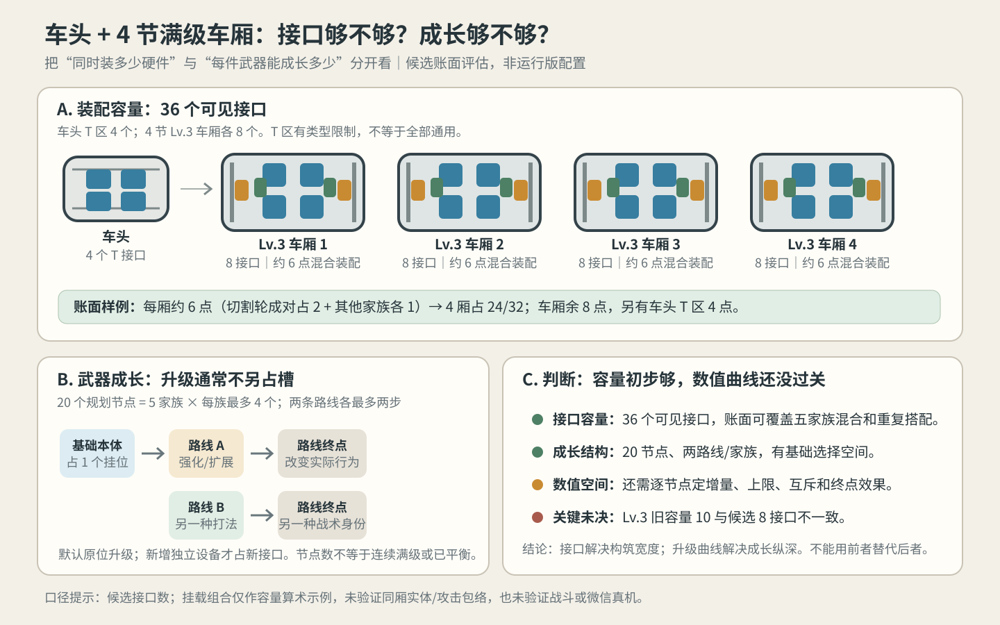

# 车头 + 4 节车厢：武器槽位与成长空间评估 V0.1

日期：2026-10-18。状态：**已更新槽位计数；旧比例图仍是历史图，不能代表当前接口形状。**现行基线见[槽位规范V0.2](./武器装配槽位基础规范V0.2.md)与[线稿V0.2](./武器装配槽位线稿示意V0.2.svg)。本文件只评估接口数量，不改运行配置/伤害数值；“能同时装多少”和“已装武器能成长多少”仍须分别判断。

## 结论

**当前同级编组接口数为Lv.1 18、Lv.2 28、Lv.3 38；全员Lv.3时车头6个T接口、四节车厢共32个接口。**升级沿已安装接口原位发生，不随每个升级节点另占一格，因此槽位数不会限制升级深度。满载组合的实体净空仍未验证。

但“有足够接口”不等于“数值成长已经够丰富”：目前五家族规划为20个专属升级节点、每族两条路线，结构上有成长选择；新提案家族尚未完成空间审查与数值定义，现有家族的数值也不能仅凭节点数证明成长节奏和平衡合格。结论应写为：**接口容量初步够；成长结构有框架；最终数值空间与平衡尚未证实。**

## 一、接口容量估算

| 部位 | 接口结构 | 接口数 | 口径 |
|---|---:|---:|---|
| 车头 Lv.1/2/3 | 2列×1/2/3排T区 | 2/4/6 | T区有专门武器适配约束，不默认能替代车厢侧壁挂位 |
| Lv.3车厢×4 | 每厢2列×4排 | 32 | 每厢8个可见接口 |
| 合计 Lv.1/2/3 | 车头+4厢 | **18/28/38** | Lv.3其中车厢32、车头T区6 |

以已有五家族构筑估算口径作容量压力样例：每节Lv.3车厢约6点——切割轮占对称的一对接口（2点），其余四个家族各占一个接口（4点）。四节车厢各放一组，共占24/32个车厢接口，车厢侧尚余8点；车头另有6个T接口。故账面上可继续放重复武器、偏科构筑或替换组合；接口类型和同车净空仍需核对。

**边界：**这只是点数层面的压力估算，不表示这五件设备已经通过同一节车厢的实体位置、攻击/运行包络、轮组遮挡或弹道落点检查。车头6个T接口也不能无条件并入通用池。若某升级产生新独立发射器或额外硬件，应按真实设备新增占位；仅改变既有设备的等级、攻击参数或该设备派生出的无人机/投射物，不另计装配接口，除非规则明确要求安装第二台设备。

## 二、成长节点与数值空间

现有规划是五个家族各最多4个武器专属节点，共20个；每族两条最多两节点的路线。三类现役家族目前各有4个节点；拒止/地雷和穿透冲击的8个节点仍是候选提案。节点表示玩家可获得的升级选择，不是统一角色等级，也不应误读为20次升级都要连续发生。

| 成长维度 | 玩家能感受到的变化 | 是否新增装配接口 |
|---|---|---|
| 输出强化 | 单次伤害、命中间隔、有效持续时间 | 否，原位强化 |
| 工作范围/覆盖 | 刀盘横向行程、电弧可达距离、布雷扇区/纵列 | 否；须在既定攻击包络内重新核对 |
| 攻击规则 | 电弧逐级传导、无人机分区巡防、穿透路径 | 否；逻辑与攻击效果升级，不自动新增硬件 |
| 可见设备/派生物数量 | 两架无人机、更多地雷等 | 通常不占新安装位；但需计入场上实体、性能与运行空间 |
| 新的独立武器本体 | 新炮口/新拒止器/第二台发射装置 | **是**，须有空接口且净空合格 |

因此38个满级接口主要决定“同时带几套硬件/如何混搭”，并不决定每个武器能有几次数值升级。数值成长需要独立定义每个节点的提升对象、前置、选择互斥关系、作用上限和单位。伤害、频率、射程、持续时间、控制时间、目标数、覆盖面积等不可简单相加成单一战力值，也不能把“范围更大”和“伤害更高”同时塞进每个节点，否则路线差异会消失。

## 三、应采用的容量与数值门槛

1. 槽位容量沿接口计数：当前规划按车头2/4/6、车厢4/6/8映射；全员Lv.3的38为规划接口合计。运行配置尚未同步，不能写成代码已通过。
2. 升级默认在原接口原位替换/强化，不再扣第二个槽位；只有明确增加独立硬件时才占新接口。
3. 节点数可以支撑第一版选择面：20节点/5家族，平均每族4节点、两条有方向的路线。候选家族未过挂位和运行包络审查前，不将其计为正式可用成长内容。
4. 数值平衡仍缺统一的测试对象与曲线：每族需有基础输出、各节点增量、路线终点效果、有效工作区和关卡敌人耐久/数量作为对照；否则无法判断一次升级是否有感、路线间是否等价、构筑是否有明显最优解。

## 评估状态

- 车头+4厢接口合计18/28/38：**公式核算 PASS**（2/4/6 + 4×4/6/8）。
- 五家族混合构筑约6点/厢，四厢占24/32：**基于现有规划的账面估算 PASS**；实体共存与最大运行净空**未验证**。
- 20节点与两路线/家族：**结构规划已存在**；不是已完成数值平衡。
- 运行配置与新接口映射：**未落地**。
- 新候选家族数值、全家族升级曲线、实战成长节奏、微信真机：**未验证**。

## 下一步

本轮只回答容量和成长空间，不改配置。下一轮如果继续，应先解决Lv.3“8接口/10容量”的定义冲突，再依次给五家族建立数值表（基础值→路线节点→终点），并将可见成长与实战效果分开验收；候选武器先通过挂位和最大运行空间审查，不因总槽位富余而跳过空间门槛。
